# 《奶蛙测试》(`The Naiwa Test`)

[](https://weixin.qq.com/sph/An74vZLV3b)
[](https://v.douyin.com/jFsSveywc4A)
[](./LICENSE)
[](#自己跑起来看看)

AI 圈里有个老梗叫「画一只骑自行车的鹈鹕」，用来测大模型写 SVG 的本事。后来 Elbert 把这个梗做成了纯代码动画 [`pelican-test`](https://github.com/orbitoo/pelican-test)。

我看完手痒，把鹈鹕请下了车，换上这只眼神呆滞、挺着大圆肚子的**奶蛙**，顺手把整个画廊重构成适合手机刷的 `9:16` 竖屏，让它一口气蹬车穿过人类 6,000 年的 20 道画框。

仓库里只开源全部源码和高清剧照，不提供 MP4 下载。想看带 120BPM 卡点配乐和原版笑声的完整成片，直接去抖音或视频号看就行（顺手点个赞就更妙了）：

- 抖音：https://v.douyin.com/jFsSveywc4A
- 微信视频号：https://weixin.qq.com/sph/An74vZLV3b

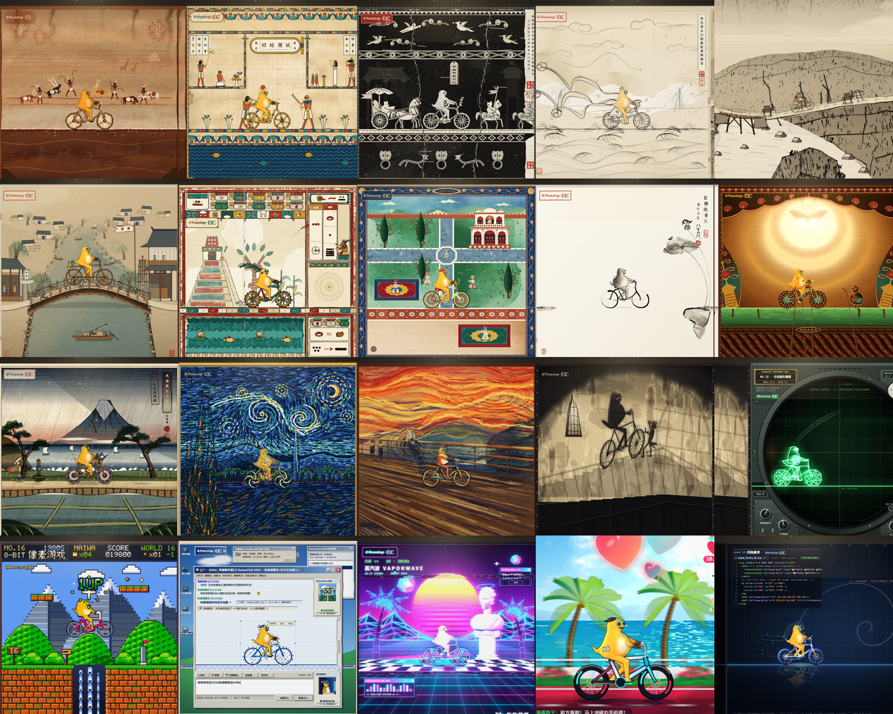

---

## 里面藏了些什么活儿

最省事的做法当然是抠一张奶蛙贴图，在 20 张背景上从左移到右。但那样一眼假，也没劲。所以这 91 秒里，奶蛙每闯进一个年代，浑身上下都跟着那个年代的画具重画了一遍。

到了北宋《溪山行旅图》（`#05`），巨峰底下的木栈道窄得像根线。把镜头推近 `2.75` 倍（底层专门按 `3000×3000` 超采样重绘，不然放大必糊），才能在山脚逮到背着竹编小斗笠的奶蛙。它身上的焦墨折线和淡赭藤黄，跟前后两头受惊的小毛驴是同一管毛笔画出来的。

进了现代艺术就彻底放飞了。梵高《星月夜》（`#12`）里，圆肚皮顺着曲率铺满刮刀厚涂油彩，蛙眼特意压成暗橄榄绿，免得在油画里像贴上去的塑料片。到了蒙克《呐喊》（`#13`），整只蛙被桥上的声波拧成干粉彩条带，平时的死鱼嘴也张成了那个标志性的竖椭圆「O」。

千禧年之后塞了不少私货：`#17` 的老聊天窗口弹出来会轻轻晃一下（特意收住了幅度，不晕人），奶蛙就在底下的画图板里闷头蹬车；`#19` 直接切进 `@Nonstop` 的滨海跟拍视角，热搜词条、错层弹幕和右下角转动的蓝底 `P` 字黑胶都在。

最后镜头拉远成一面 `3×7` 的展墙，墙上 20 幅画里的奶蛙全都在各自画框里继续骑车。紧接着镜头推向右下角第 21 格的新闻发布会：面对七支话筒，绷了六千年的奶蛙本人终于没忍住，拍着大肚皮笑出了原声。

全片左上角的 `@Nonstop × ERC` 水印也跟着换了 22 套衣服。古埃及里它是双股金绳捆扎的王名圈，汉画像石里带刀凿崩边，唐宋卷轴里是残边朱文印，1950 年代变成示波器金属面板上的绿光电子束，最后一幕直接长在了代码编辑器的标题栏里。

---

## 1:1 局部放大看看笔触

| #05 宋代山水：和栈道小毛驴一个画风的铁线描奶蛙 | #12 梵高《星月夜》：顺着圆肚铺的厚涂油彩与橄榄绿蛙眼 | #13 蒙克《呐喊》：干粉彩扭曲条带、漩涡肚皮与「O」嘴 |
| :---: | :---: | :---: |
|  | 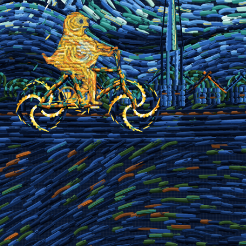 | 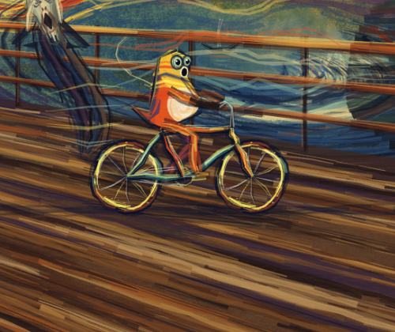 |

| #07 玛雅抄本：树皮纸线描与石雕铭文块 | #15 示波器：黄铜铭牌与金属副板上的荧光束 | #18 蒸汽波：双层霓虹灯牌与老录像机 OSD |
| :---: | :---: | :---: |
| 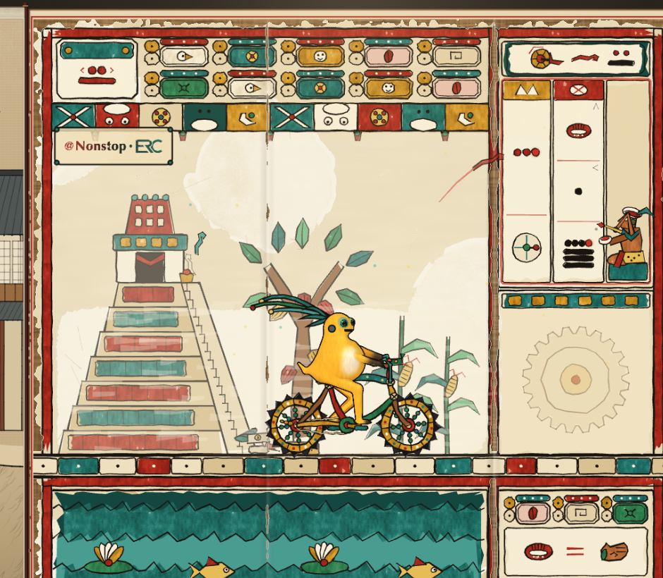 |  | 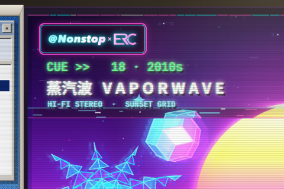 |

| #19 短视频：热搜词条、错层弹幕与蓝底 P 头像 | #19 短视频：`@Nonstop` 账号与黑胶唱片中心标 | #20 代码美学：直接长在 IDE 标题栏里的发光标识 |
| :---: | :---: | :---: |
|  |  | 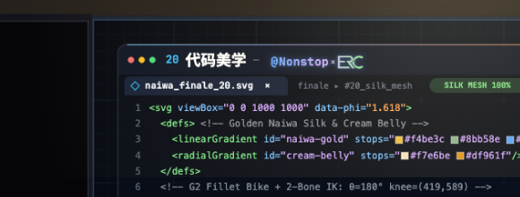 |

### 跟着年代变装的 `@Nonstop × ERC`

| 古埃及双股金绳王名圈 | 东汉刀凿崩边石刻拓印 | 盛唐铁笔朱文残印 | 1985 红白机整数像素块 |
| :---: | :---: | :---: | :---: |
| 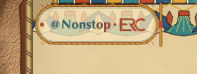 |  |  |  |

---

## 全片 22 幕竖屏剧照（`1080×1920`）

| 片头 · 古籍摹本底稿 | #01 · 撒哈拉岩画（约前 4000） | #02 · 古埃及壁画（约前 1300） | #03 · 汉画像石拓片（约 100） |
| :---: | :---: | :---: | :---: |
|  |  |  | 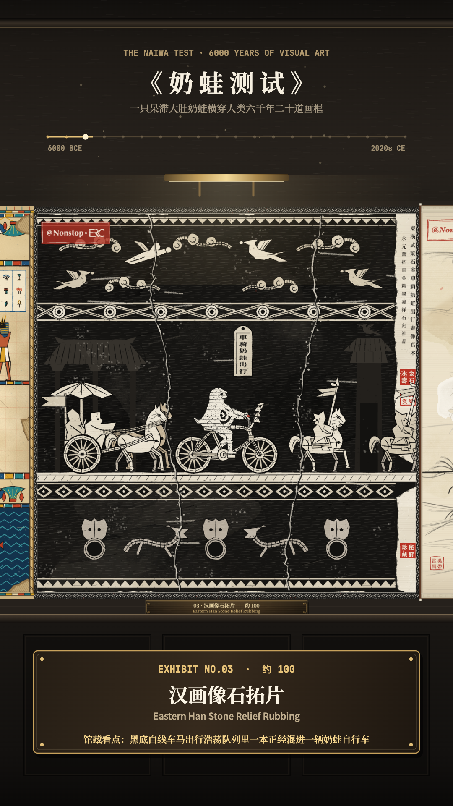 |

| #04 · 唐代白描（约 750） | #05 · 宋代山水（约 1000） | #06 · 清明上河图（约 1120） | #07 · 玛雅抄本（约 1200） |
| :---: | :---: | :---: | :---: |
| 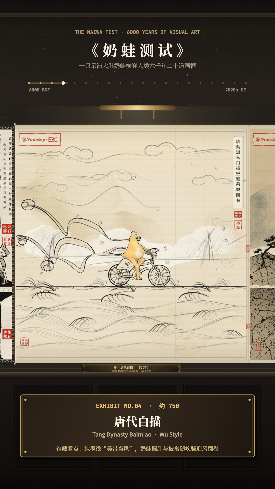 | 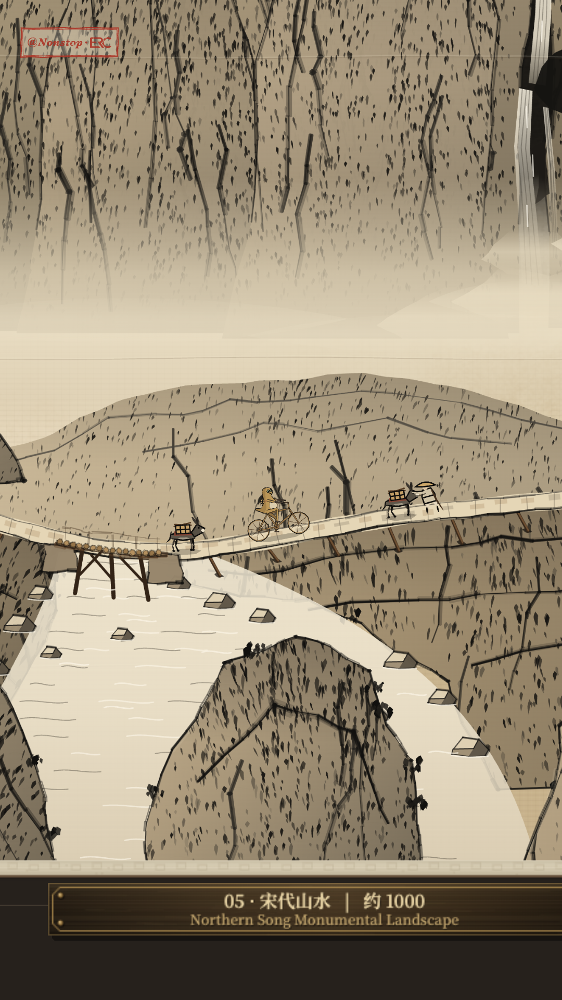 |  |  |

| #08 · 莫卧儿细密画（约 1600） | #09 · 八大山人写意（约 1690） | #10 · 爪哇皮影戏（约 1750） | #11 · 浮世绘（约 1830） |
| :---: | :---: | :---: | :---: |
|  |  |  | 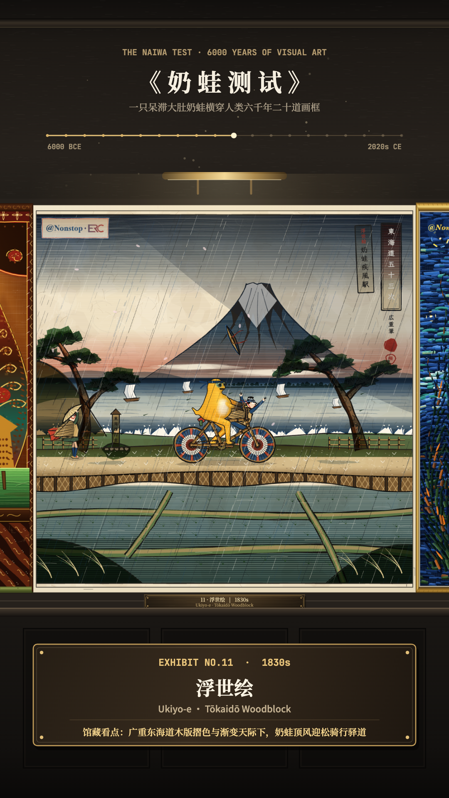 |

| #12 · 梵高《星月夜》（1889） | #13 · 蒙克《呐喊》（1893） | #14 · 《诺斯费拉图》（1922） | #15 · 示波器矢量图（1950s） |
| :---: | :---: | :---: | :---: |
|  |  |  |  |

| #16 · 8-bit 像素游戏（1985） | #17 · 早期聊天窗口（2000s） | #18 · 蒸汽波（2010s） | #19 · 竖屏短视频（2020s） |
| :---: | :---: | :---: | :---: |
|  |  | 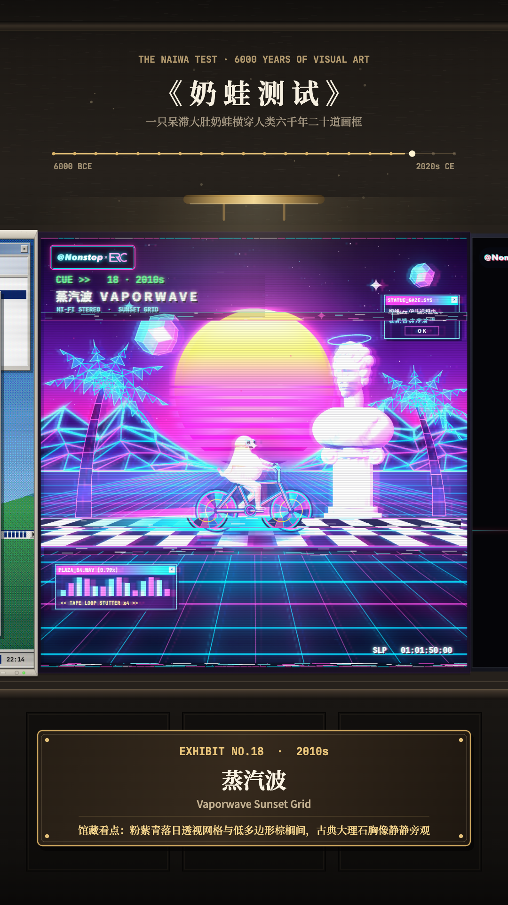 | 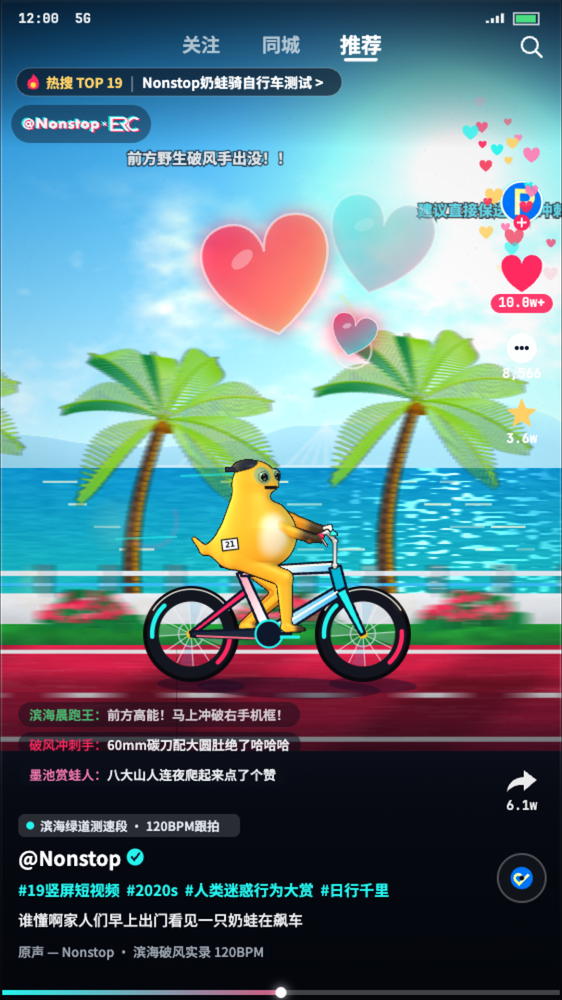 |

| #20 · 代码美学（2020s） | 片尾 · 3×7 全墙 20 格同时骑车 | 片尾 · 第 21 格奶蛙本人笑场 | 片尾 · 走廊一闪而过的车铃 |
| :---: | :---: | :---: | :---: |
| 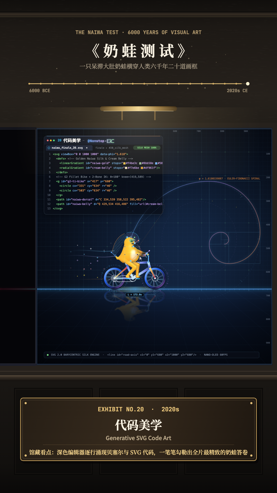 |  |  | 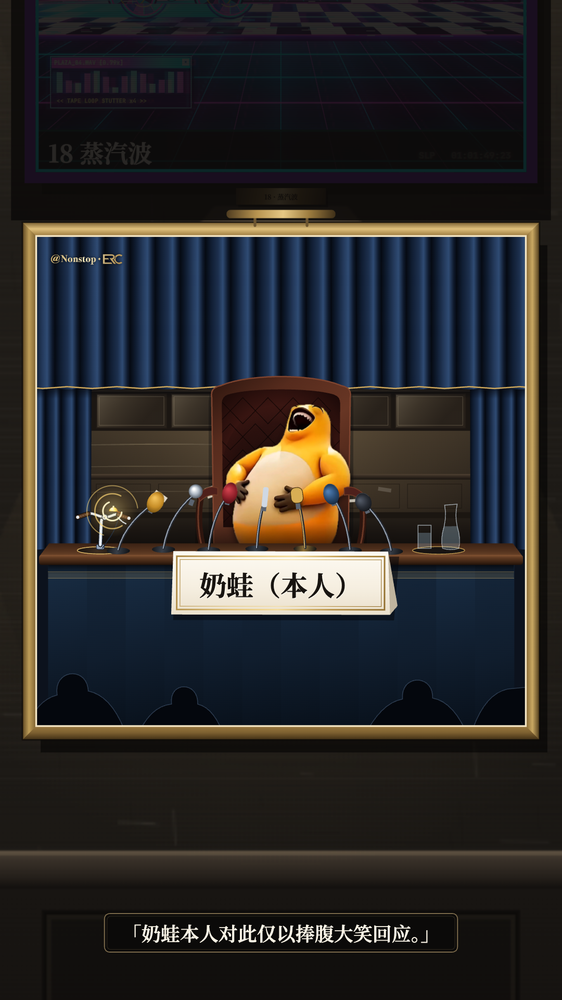 |

---

## 自己跑起来看看

整个项目**零 NPM 依赖**，连 `npm install` 都省了。克隆下来起个本地静态服务就能在浏览器里实时跑（带进度条拖拽、跳幕和 Web Audio 实时合成配乐）：

```bash
git clone https://github.com/ericchan916/naiwa-test.git
cd naiwa-test
python3 -m http.server 8080
```

浏览器打开 `http://127.0.0.1:8080`，按空格键发车。

如果你想自己跑一遍关键帧校验或者本地离线渲染（需要本机装有 Chrome、`ffmpeg` 和 Node.js `>= 22`）：

```bash
node build_video.mjs --verify   # 跑一遍 26 张关键帧自检
node build_video.mjs --render   # 本地 6 路并发渲染完整视频
```

---

## 目录说明

```text
.
├── index.html          # 浏览器实时预览入口（空格播放、方向键快进、支持跳幕）
├── render.html         # 无头 Chrome 逐帧确定性渲染页
├── build_video.mjs     # 零依赖 CDP 并发渲染与 48kHz 音轨合成脚本
├── assets/panels/      # 辅助肌理、精抠大笑序列帧、笑声采样与品牌标识
├── public/             # 本地字体与 p5.js / p5.brush
├── screenshots/        # 26 张竖屏剧照 + 14 张 1:1 局部特写 + 20 时代总览图
└── src/
    ├── main.js         # 9:16 帧调度器与宋代山水 3× 超采样直出层
    ├── audio/          # 120BPM 20 时代 Web Audio 合成器编曲
    ├── beat/           # 时间轴与竖屏镜头运动曲线
    ├── kit/            # 离屏烘焙缓存、画框过渡、环境动态与 22 款跨时代水印
    ├── rig/            # 双骨 IK 骑行骨架与多媒介着色器
    └── scenes/         # Intro + s01..s20 二十个年代场景 + Outro 展墙与发布会
```

---

## 致谢与协议

- 原版创意与引擎底座来自 Elbert 的 [**`orbitoo/pelican-test`（《鹈鹕测试》）**](https://github.com/orbitoo/pelican-test)
- 奶蛙 `9:16` 竖屏重制、20 年代画风适配与细节打磨：**EricChan (`@Nonstop` × `ERC`)** · [抖音](https://v.douyin.com/jFsSveywc4A) · [视频号](https://weixin.qq.com/sph/An74vZLV3b)
- 代码采用 **[MIT License](./LICENSE)** 开源。
